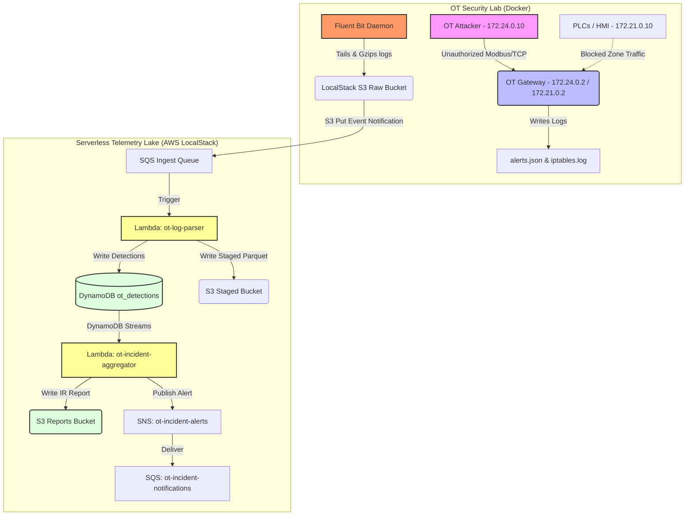

# Cloud Telemetry Lake

[](https://www.terraform.io/)
[](https://localstack.cloud/)
[](https://fluentbit.io/)
[](https://aws.amazon.com/lambda/)
[](https://github.com/LiamCarPer/cloud-telemetry-lake/actions/workflows/ci.yml)

An end-to-end industrial cybersecurity telemetry pipeline that ingests, parses, analyzes, and archives security event logs generated from a simulated Operational Technology (OT) network segmented according to the **Purdue Reference Model**.

The system collects raw network traffic drops and Intrusion Detection System (IDS) alerts from the OT Gateway, processes them serverlessly in real time, writes stateful detection records to DynamoDB, generates structured Incident Response reports, and stages long-term analytical data in columnar Parquet format.

---

## Architecture



---

## Core Features

*   **Purdue Model Network Simulation:** Multi-zone Docker environment covering Level 4/5 (IT/Attacker), Level 3 (Operations Gateway), and Level 1/2 (Control Zone with Modbus PLCs).
*   **Custom IDS Rule Engine:** Gateway runs Scapy-based Python listeners detecting:
    *   `CROSS_ZONE_VIOLATION` (MITRE T0886): Direct communication attempts bypassing Level 3 boundary rules.
    *   `UNAUTHORIZED_MODBUS_WRITE` (MITRE T0831): Unauthorized Modbus register writes from untrusted sources.
    *   `OT_BRUTE_FORCE_SCAN` (MITRE T0846): Excessive Modbus exceptions indicating scanner or brute-force activity.
*   **Firewall Log Capture:** Mock packet sniffer emulates kernel iptables drop entries for cross-zone policy blocks.
*   **Structured Log Shipping:** Fluent Bit collects, compresses, and ships log streams to S3 with Hive-partitioned keys (`source=`, `date=`).
*   **Serverless Ingestion Pipeline:** S3 events → SQS → Lambda parses and routes logs with dynamic gzip detection.
*   **Stateful Security Correlation:** Detection records written to DynamoDB with GSIs for severity and host-based querying.
*   **Automated Incident Response:** DynamoDB Streams trigger the aggregator Lambda to produce NIST SP 800-61 IR reports, grouped into deterministic `INCIDENT_WINDOW_SECONDS` windows so a retried stream batch regenerates the same report, and publish SOC alerts via SNS.
*   **Analytical Storage:** Parsed logs staged as snappy-compressed Apache Parquet, partitioned by source and date.
*   **Cloud Identity Detection Plane:** CloudTrail management events and GuardDuty findings feed a dedicated identity detector with seven CloudTrail rules, ATT&CK Enterprise tagging, and the same DynamoDB → NIST report → SNS path.
*   **Kubernetes Detection Plane:** API-server audit logs and Falco runtime events feed a dedicated Kubernetes detector with eight audit rules, runtime normalization, ATT&CK for Containers tagging, and a reproducible kind audit lab.
*   **Vulnerability Management Plane:** Nessus XML and Qualys XML/JSON exports are normalized, deduplicated across scanners, enriched with EPSS and CISA KEV, weighted by asset criticality, and written to DynamoDB and Parquet. A separate reporter produces JSON/CSV/Markdown remediation plans with SLA due dates and SNS summaries.
*   **Security-Hardened Delivery:** CMK encryption for data, logs and secrets; Secrets Manager for the threat-intel key; scoped IAM with a permissions boundary; CloudWatch alarms on pipeline failure paths; and CI supply-chain scanning (gitleaks, Checkov, Bandit, pip-audit).

---

## LocalStack & Engineering Workarounds

This project is deployed against **LocalStack Community Edition** as a local AWS emulation environment. Three platform constraints required explicit engineering solutions:

1.  **Fat-Zip Dependency Packaging:** LocalStack Community does not mount Lambda Layers to `/opt` at runtime. Dependencies (`pandas`, `awswrangler`, etc.) are bundled directly inside the deployment archive under `python/` and injected into `sys.path` at cold-start time.
2.  **S3-Based Lambda Deployment:** The fat-zip archive exceeds the 50 MB AWS direct API upload limit. Terraform stages the zip to S3 first (`aws_s3_object`) and provisions the function by S3 reference (`s3_bucket` / `s3_key`).
3.  **Dynamic Gzip Detection:** Fluent Bit uploads gzip-compressed payloads with a `.json` key extension. The Lambda handler inspects the first two magic bytes (`\x1f\x8b`) at runtime and renames the file with a `.gz` suffix before passing it to the parser, enabling transparent decompression.

All three workarounds are reversible: the Terraform variables `localstack_endpoint` (set to `""`) and `force_destroy` (set to `false`) switch the stack to a real AWS account, and the dependency excludes in `terraform/lambda.tf` are already stubbed out in comments for a standard Lambda layer deployment. The Fluent Bit outputs default to the LocalStack endpoint with TLS off; for production, point them at the regional S3 endpoint and set `tls on`.

---

## Reliability & Failure Handling

*   **Selective SQS retries:** the parser Lambda implements partial batch responses (`ReportBatchItemFailures`). Only messages that failed for transient reasons (object download, DynamoDB, Parquet or DLQ writes) are returned to the queue; records that are routed to the S3 DLQ bucket by design are acknowledged.
*   **Ingest dead-letter queue:** `ot-log-ingest-queue` redrives to `ot-log-ingest-dlq` after 3 failed receives.
*   **Idempotent detections:** every detection row carries a deterministic 16-character SHA-256 event ID inside its sort key (`timestamp#event_hash`), so an SQS retry overwrites the same DynamoDB item instead of duplicating it.
*   **Idempotent incident reports:** the aggregator derives a UUIDv5 incident ID from the incident window and the sorted detection identities; a retried DynamoDB Streams batch rewrites the same `incidents/<id>.json` object.
*   **Unparseable records:** individual lines that fail parsing are written to the DLQ bucket under `unparseable/date=<date>/source=<source>/`, preserving the original error for review.

---

## Identity Detection Plane

The repo has a second detection plane for AWS control-plane activity:

*   **CloudTrail (management events):** trail → identity bucket → SQS → `ot-identity-detector` → detections + staged Parquet. Seven rules cover root use, console login without MFA, access-key creation, IAM policy changes, CloudTrail/GuardDuty tampering, and console brute force.
*   **GuardDuty findings:** EventBridge rule → SQS → the same detector, normalized with finding type, severity, affected principal/resource, remote IP and ATT&CK tactic.
*   **Shared model:** detections land in `ot_detections` with `detection_domain = "identity"`; reports expose `mitre_techniques_by_framework = {ics, enterprise}` and list tactics separately.
*   **Gated services:** `enable_cloudtrail` and `enable_guardduty` default to `false` because LocalStack Community does not implement those services. The ingestion paths are exercised locally with committed CloudTrail fixtures and GuardDuty-shaped EventBridge events.

```bash
make identity-demo
```

---

## Kubernetes Detection Plane

The third detection plane covers container and cluster activity:

*   **Kubernetes audit logs:** API-server audit policy → Fluent Bit → `ot-k8s-raw` S3 → SQS → `ot-kubernetes-detector` → detections + staged Parquet. Eight rules cover pod exec/attach, privileged pods, sensitive hostPath mounts, cluster-admin bindings, secret access, anonymous access, RBAC changes and admission-webhook tampering.
*   **Falco runtime events:** Falcosidekick → SQS → the same detector, normalized with rule, priority, namespace/pod/container, process, file and source IP. Falco owns the runtime rules; the pipeline owns normalization, severity, dedupe and reporting.
*   **EKS:** GuardDuty EKS Runtime Monitoring findings already flow through the GuardDuty path and are tagged as Kubernetes/containers findings. The EKS audit-log CloudWatch path is documented as a production integration rather than emulated locally.
*   **Shared model:** detections carry `detection_domain = "kubernetes"`; reports add a `containers` ATT&CK framework and a Kubernetes detection count.
*   **Local lab:** `lab/kubernetes/` contains a kind cluster config with API-server audit logging, demo attack manifests and a Fluent Bit shipper. `make k8s-demo` exercises the same paths without a cluster.

```bash
make k8s-demo
```

---

## Vulnerability Management Plane

The fourth plane turns scanner exports into a prioritized remediation queue:

*   **Formats:** Nessus `.nessus` XML, Qualys VM XML and Qualys VM JSON. XML parsing uses the standard library with explicit DTD/entity rejection, so scanner input cannot expand external entities.
*   **Normalization:** findings are keyed by source, asset, plugin, port and protocol. A cross-scanner key (`asset + primary CVE + port + protocol`) merges the same issue reported by Nessus and Qualys into one remediation item while preserving both `finding_ids` and `sources`.
*   **Asset inventory:** a CSV or JSON object at `s3://ot-vuln-raw-<account>/inventory/assets.csv` supplies `asset_id`, hostname/IP/FQDN and criticality. Explicit criticality (1–5) wins; otherwise Purdue level or security zone derives it, with a default of 3. Unknown assets are flagged, not silently trusted.
*   **Enrichment:** EPSS is fetched from FIRST with a DynamoDB TTL cache; CISA KEV is fetched from the public catalog. Missing EPSS is treated as 0 and counted in the report's data-quality block rather than invented.
*   **Scoring:** `40% CVSS + 30% EPSS + 30% asset criticality + 10% KEV/exploit bonus`, normalized to 0–100. Buckets are `CRITICAL >= 80`, `HIGH >= 60`, `MEDIUM >= 40`, `LOW < 40`; SLA due dates are 7/30/90/180 days from `first_seen`.
*   **Lifecycle:** `first_seen` is the earliest scanner observation and never moves forward; `last_seen` advances on every scan; analyst statuses `accepted` and `false_positive` survive re-scans. Findings are **never closed automatically**.
*   **Storage:** `ot_vulnerabilities` (finding rows with `asset-index`, `priority-index`, `status-index` and `scan-index`), `ot_vulnerability_cves` (CVE → finding lookup) and `ot_enrichment_cache` (TTL). The processor also stages partitioned Parquet under `vulnerabilities/scan_date=<date>/source=<scanner>/`.
*   **Reporting:** `ot-vulnerability-reporter` queries the `status-index` (never a table scan), writes `report.json`, `report.csv` and `report.md` under `remediation/<report_id>/` and `remediation/latest/`, and publishes a summary to `ot-vuln-reports`. The daily EventBridge schedule is gated by `enable_vuln_reports` (default `false`) so local demos invoke the reporter directly.

```bash
make vuln-demo     # upload inventory + Nessus/Qualys fixtures
make vuln-report   # JSON/CSV/Markdown in /tmp/opencode/vuln-report
```

The committed fixtures produce 9 findings, 6 deduplicated remediation items, 4 critical items, and 2 KEV findings (Log4Shell and CVE-2024-3400). The live run also verified `first_seen` preservation and `last_seen` advancement across two scan dates.

---

## Security Controls

| Area | Implementation |
| :--- | :--- |
| **IAM** | Per-function roles with scoped ARNs and a permissions boundary; log permissions scoped to each function's log group; no `dynamodb:Scan`/`DeleteItem`; queue policies pin `aws:SourceArn` and `aws:SourceAccount`. |
| **Secrets** | The AbuseIPDB key lives in Secrets Manager behind a customer-managed KMS key. Terraform creates the secret container only, so the value never enters git or Terraform state. `make seed-secret` stores it locally. |
| **Encryption** | SSE-KMS on S3, SQS and DynamoDB; CMK-encrypted CloudWatch Logs, Secrets Manager and Lambda environment variables; TLS-only S3 bucket policy and public-access blocks. |
| **Monitoring** | CloudWatch alarms for Lambda errors/throttles, ingest queue age and DLQ depth, routed to the `ot-ops-alerts` topic (set `ops_alert_email` to receive mail). |
| **Identity detection** | CloudTrail and GuardDuty feed a dedicated identity Lambda; detections carry `detection_domain=identity`. The real trail/detector are gated because LocalStack does not implement them. |
| **Kubernetes detection** | Audit logs and Falco events feed a dedicated Kubernetes Lambda; detections carry `detection_domain=kubernetes`. A kind audit lab proves the live path; EKS managed logging is documented as a production integration. |
| **Vulnerability management** | Scanner exports feed a dedicated processor and reporter; EPSS/KEV enrichment, explainable scoring, SLA due dates, JSON/CSV/Markdown reports, and a gated daily schedule. The reporter queries a GSI instead of scanning DynamoDB. |
| **Pipeline** | GitHub Actions pinned to commit SHAs, read-only token permissions, gitleaks secret scanning, Checkov for Terraform, Bandit for Python, pip-audit for dependencies, Dependabot and dependency review. |

Control details, the threat model and residual risks are in [`docs/SECURITY.md`](docs/SECURITY.md); the disclosure policy is [`SECURITY.md`](SECURITY.md).

```bash
make test          # includes security-invariant regression tests
make security      # bandit + pip-audit + checkov
ABUSEIPDB_API_KEY=... make seed-secret
make alarm-test    # proves a CloudWatch alarm reaches the ops SNS topic
```

The stack was applied and exercised against LocalStack 4.14.0: parser detections, Parquet staging, deterministic incident reports, SNS→SQS delivery, cold-start secret resolution, and a CloudWatch alarm transition delivered to the operations sink queue.

---

## Getting Started

### 1. Prerequisites

*   [Docker](https://www.docker.com/) and Docker Compose V2
*   [Terraform](https://www.terraform.io/) >= 1.0
*   [AWS CLI](https://aws.amazon.com/cli/)

### 2. Deploy Infrastructure

```bash
# Start LocalStack Community. 4.14.0 is pinned because the 2026 `latest`
# image requires a license token; this is the version the stack was verified on.
docker run -d --name localstack -p 4566:4566 localstack/localstack:4.14.0

# Deploy all AWS resources via Terraform
cd terraform
terraform init
terraform apply -auto-approve
```

### 3. Start the OT Security Lab

```bash
cd ../ot-security-lab/lab-environment
docker compose up -d

# Apply zone firewall rules to the gateway
docker cp network-config/firewall-rules.sh ot_gateway:/firewall-rules.sh
docker exec ot_gateway chmod +x /firewall-rules.sh
docker exec ot_gateway /firewall-rules.sh
```

### 4. Start Gateway Detection Daemons

```bash
docker exec -d ot_gateway python3 /scripts/sniffer.py
docker exec -d ot_gateway python3 /detection/rules/cross_zone_traffic.py
docker exec -d ot_gateway python3 /detection/rules/modbus_anomaly.py
docker exec -d ot_gateway python3 /detection/rules/ot_brute_force.py
docker exec -d ot_gateway python3 /detection/rules/process_safety_violation.py
```

### 5. Run the Attack Simulation

```bash
docker exec -it ot_attacker python3 /attacker/simulate_attack.py
```

### 6. Upload Malcolm NDR Fixture Alerts (Optional)

Uploads a batch of Suricata EVE-format alerts simulating a Malcolm NDR sensor feed:

```bash
python3 src/malcolm_fixture/upload_malcolm_alerts.py --endpoint-url http://localhost:4566
```

### 7. Run the Tests

```bash
python3 -m unittest discover -s tests -t . -v
```

The suite covers the OT, identity, Kubernetes and vulnerability parsers; 7 OT, 7 identity and 8 Kubernetes rules; Falco/GuardDuty normalization; vulnerability scoring, dedup, lifecycle and reporting; window expiry; the DynamoDB state-store update contract; SQS partial batch responses; secret loading; guard rails; ATT&CK framework grouping; and NIST report construction. It is 136 tests; `make test` runs the same command.

### 8. Run the Identity Demo

Uploads the committed CloudTrail fixtures to the identity bucket and emits a GuardDuty-shaped finding through EventBridge:

```bash
make identity-demo
```

Then verify identity detections and staged partitions:

```bash
AWS_ACCESS_KEY_ID=mock AWS_SECRET_ACCESS_KEY=mock AWS_DEFAULT_REGION=us-east-1 \
aws --endpoint-url=http://localhost:4566 dynamodb scan --table-name ot_detections \
  --filter-expression 'detection_domain = :d' \
  --expression-attribute-values '{":d":{"S":"identity"}}'

AWS_ACCESS_KEY_ID=mock AWS_SECRET_ACCESS_KEY=mock AWS_DEFAULT_REGION=us-east-1 \
aws --endpoint-url=http://localhost:4566 s3 ls s3://ot-telemetry-staged-000000000000/parsed/ --recursive
```

### 9. Run the Kubernetes Demo

Uploads the committed audit EventList and sends a Falco event to the runtime queue:

```bash
make k8s-demo
```

Verify Kubernetes detections and staged partitions:

```bash
AWS_ACCESS_KEY_ID=mock AWS_SECRET_ACCESS_KEY=mock AWS_DEFAULT_REGION=us-east-1 \
aws --endpoint-url=http://localhost:4566 dynamodb scan --table-name ot_detections \
  --filter-expression 'detection_domain = :d' \
  --expression-attribute-values '{":d":{"S":"kubernetes"}}'
```

For a real API server, `lab/kubernetes/` contains the kind audit config, demo workloads and Fluent Bit shipper; see `lab/kubernetes/README.md`.

---

### 10. Run the Vulnerability Demo

Uploads the asset inventory plus Nessus and Qualys fixtures. The S3 notification drives the processor; the reporter can then be run locally or invoked in Lambda:

```bash
make vuln-demo
make vuln-report

# Or invoke the deployed reporter (writes S3 + SNS):
AWS_ACCESS_KEY_ID=mock AWS_SECRET_ACCESS_KEY=mock AWS_DEFAULT_REGION=us-east-1 \
aws --endpoint-url=http://localhost:4566 lambda invoke \
  --function-name ot-vulnerability-reporter --payload '{}' /tmp/vuln-report-response.json
```

---

## Analytics & Security Data Lake Querying

### 1. Production AWS Architecture (Athena & Glue)
In a production AWS environment, the structured telemetry and incident reports are queried using Amazon Athena. The database schemas are declared via Terraform in `terraform/analytics.tf`:
- **Database**: `ot_telemetry`
- **Tables**:
  - `staged_telemetry`: An external snappy-parquet table mapped to `s3://ot-telemetry-staged-<account_id>/parsed/` partitioned by `date` (string) and `source` (string).
  - `incident_reports`: An external JSON table mapped to `s3://ot-telemetry-reports-<account_id>/incidents/` parsing incident reports structure.
  - `vulnerability_findings`: An external snappy-parquet table mapped to `s3://ot-telemetry-staged-<account_id>/vulnerabilities/` partitioned by `scan_date` and `source`.

*Note: Since Glue and Athena are premium APIs not implemented in the free LocalStack Community Edition, these resources are disabled by default in local deployments via the feature flag `enable_analytics = false`. Set this flag to `true` when deploying to a real AWS account.*

### 2. AWS Athena Named Queries
Eighteen production-ready analytical queries are pre-defined in the repository:
1. **High-Severity OT Anomalies Over Time**: Groups and aggregates high-severity alerts (`CROSS_ZONE_VIOLATION`, `UNAUTHORIZED_MODBUS_WRITE`, `OT_BRUTE_FORCE_SCAN`) by date and source.
2. **Top Noisy Hosts**: Identifies the most active logging sources across the network.
3. **SCADA TTP Patterns**: Parses nested Malcolm NDR JSON alerts, matching specific industrial attack signatures (e.g. Modbus function code violations, S7comm lateral movement).
4. **Identity IAM Changes**: Groups CloudTrail IAM API calls by date, event, user and source IP.
5. **Identity Console Logins**: Shows console logins with MFA status and error codes.
6. **GuardDuty Findings**: Groups findings by date, type and severity.
7. **Identity/OT Source-IP Overlap**: Joins CloudTrail source addresses against OT detections to find identity activity originating from OT-network addresses.
8. **Kubernetes Exec/Attach**: Lists pod exec and attach requests with user, namespace and source IP.
9. **Kubernetes Privileged Workloads**: Finds privileged pods and sensitive hostPath mounts from the request object.
10. **Kubernetes RBAC Changes**: Lists role/binding changes by actor.
11. **Kubernetes Anonymous Access**: Finds successful anonymous requests outside health/discovery endpoints.
12. **Falco High-Severity Events**: Groups runtime events by rule, priority, namespace and pod.
13. **Open Vulnerabilities by Priority**: Counts open findings and affected assets per priority bucket, with average score.
14. **Top Remediation Queue**: The highest-scoring open findings with CVE, CVSS, EPSS, KEV and due date.
15. **KEV Exposure**: Open findings whose CVE is in the CISA KEV catalog.
16. **Vulnerability SLA Breaches**: Open findings past their SLA due date, grouped by priority.
17. **Asset Risk Ranking**: Open finding counts, critical counts and maximum score per asset.
18. **CVE Prevalence**: Assets and findings per CVE, including KEV flags.

### 3. Local Analytics Query CLI
To run these queries locally against the LocalStack emulation environment, a query client utility is provided. It uses `pandas` and `awswrangler` to run the identical SQL aggregates directly against the S3 staged parquet files:

```bash
AWS_ACCESS_KEY_ID=mock AWS_SECRET_ACCESS_KEY=mock AWS_DEFAULT_REGION=us-east-1 \
AWS_ENDPOINT_URL=http://localhost:4566 \
.venv/bin/python src/analytics/query_lake.py
```

The CLI covers the eleven OT/identity/Kubernetes hunts. The six vulnerability Athena queries are declared in Terraform; the local remediation output is generated by `make vuln-report` (JSON/CSV/Markdown), not by this CLI.

Example output (OT queries; identity and Kubernetes queries are additive):
```text
--- Security Data Lake Analytics CLI ---
Reading telemetry from s3://ot-telemetry-staged-000000000000/parsed/ (Endpoint: http://localhost:4566)...
Successfully loaded <N> telemetry logs.

=== QUERY 1: High-Severity OT Anomalies Over Time ===
      date    source  anomaly_count
2026-05-20 ot_sensor             11

=== QUERY 2: Top Noisy Hosts ===
host_identifier  log_count
         pop-os         11
     ot-gateway          9
    malcolm-ndr          4

=== QUERY 3: SCADA TTP Patterns (Malcolm NDR) ===
                      timestamp      src_ip     dest_ip scada_signature                                                      scada_category
2026-05-20T19:27:26.798635+0000 172.24.0.10 172.21.0.10 ET SCADA Modbus Unauthorized Function Code from External Host            SCADA/ICS Attack
2026-05-20T19:27:26.798635+0000 172.24.0.10 172.21.0.10 ET SCADA Modbus Write Single Register Attempt (FC 6)                    SCADA/ICS Attack
2026-05-20T19:27:26.798635+0000 172.24.0.10 172.22.0.10 ET SCADA S7comm PLC Read/Write Coils – Lateral Movement                 SCADA/ICS Lateral Movement
2026-05-20T19:27:26.798635+0000 172.24.0.10 172.21.0.10 ET SCADA Modbus Exception Response Flood – Brute Force/Scan            SCADA/ICS Reconnaissance
```

---

## Known Limitations

*   **Lab-scale, not production-scale.** The PRD (`docs/specs.md`) records target metrics (ingest latency, P95 detection latency, Lambda success rate). They are **not measured yet**: there is no load test or baseline, even though alarms now cover the failure paths.
*   **Incident grouping is per DynamoDB Streams batch, anchored to a time window.** Detections arriving in separate batches are not merged into a single incident, and there is no cross-batch correlation state.
*   **Glue and Athena resources are declarative.** They are disabled by default (`enable_analytics = false`) because LocalStack Community does not implement those APIs; the DDL and named queries are validated by Terraform, not executed against real AWS.
*   **Threat-intel enrichment is optional.** AbuseIPDB enrichment is active only when the Secrets Manager secret has a value (`make seed-secret`). GeoIP enrichment exists in the analyzer but is not wired into the Lambda deployment.
*   **Objects are staged under `/tmp` before parsing.** The Lambda downloads each object to a per-object temporary directory and then parses it line-by-line from disk rather than streaming directly from S3.
*   **Staged Parquet is at-least-once under retries.** Detection writes and incident reports are idempotent, but a retried SQS message can re-append its batch as new Parquet files, so the staged dataset may contain duplicate rows after a partial failure. Deduplication is left to the query layer.
*   **IAM enforcement is not exercised locally.** LocalStack Community does not evaluate IAM policies. The policies are reviewed, linted and unit-guarded, but their enforcement must be verified in a real AWS account.
*   **CloudTrail and GuardDuty services are gated.** LocalStack Community does not implement CloudTrail (Ultimate-only) or GuardDuty, so the trail and detector default to off (`enable_cloudtrail`, `enable_guardduty`). The identity ingestion paths are verified with committed CloudTrail fixtures through S3 and GuardDuty-shaped events through EventBridge; the real services are Terraform-validated, not exercised locally.
*   **Identity detection content is intentionally small.** Seven CloudTrail management-event rules plus GuardDuty finding normalization. There is no benign baseline or measured false-positive rate, and data events are excluded to control cost and volume.
*   **Kubernetes coverage is audit + runtime normalization, not a full platform.** Eight audit rules and Falco event normalization. No admission-controller policy, image scanning, network policy, service mesh, multi-cluster or EKS audit-log integration is implemented.
*   **The Kubernetes lab is optional and manual.** `lab/kubernetes/` was used to verify a real kind audit log through Fluent Bit → LocalStack; it is not part of CI. The managed EKS audit-log path (CloudWatch Logs → Firehose → S3) is documented as a production integration, not built or exercised.
*   **Falco is fixture/SQS-tested, not run live.** Falco owns the runtime rules; the repo normalizes and reports its events. A live Falco DaemonSet was not added because of eBPF/privilege and memory constraints in the lab.
*   **Vulnerability enrichment depends on public feeds.** EPSS and the CISA KEV catalog are fetched at ingest time; there is no offline snapshot or NVD/CPE fallback. A missing EPSS score is treated as 0 and counted in `data_quality.epss_missing`, and a missing CVSS score is estimated from scanner severity and flagged with `cvss_estimated`.
*   **Asset inventory is a single object.** There is no CMDB sync or per-asset API. Criticality comes from the CSV/JSON inventory at `inventory/assets.csv`, with Purdue/zone derivation and a default of 3 for unknown assets.
*   **Vulnerability lifecycle is intentionally conservative.** `first_seen`/`last_seen`/triage status are merged, but there is no automatic closure, reconciliation, or patch automation. A finding disappears from the report only when its status is changed or the row is removed.
*   **Cross-scanner dedup is heuristic.** The key is asset + primary CVE + port + protocol. Findings without a CVE, or the same CVE reported on different ports, remain separate; scanner plugin IDs are preserved on the source rows.
*   **Vulnerability Athena resources are declarative.** The `vulnerability_findings` table and six queries are Terraform-validated but not executed locally because LocalStack Community does not implement Glue/Athena.
*   **Security Hub, AWS Config, IAM Access Analyzer, SCPs and VPC endpoints remain out of scope.** [`docs/SECURITY.md`](docs/SECURITY.md) records them as the production baseline rather than claiming them.
*   **Secret rotation is manual.** The key is read at cold start and cached; rotating it requires a new secret version and a forced cold start. There is no rotation Lambda.
*   **One CMK covers data, logs and secrets.** This keeps key-policy review simple in the lab; production should split keys by data classification.
*   **LocalStack does not report DynamoDB PITR status.** PITR is configured in Terraform, but LocalStack's `describe-table` omits the recovery description and does not exercise restore.
*   **Unparseable-line batches in the S3 DLQ are not alarmed directly.** SQS DLQ depth is alarmed; S3 DLQ review is manual.
*   **There is no automated deployment.** CI validates but holds no AWS credentials; Terraform is applied manually. An OIDC deploy role is a documented next step, not an implemented one.
*   **Unit coverage, not integration coverage.** The deployed pipeline is verified manually with the AWS CLI commands below; it is not exercised by an automated end-to-end test.

---

## Verification


Once the simulation completes, Fluent Bit ships logs to S3, the parser Lambda processes them, and the aggregator Lambda generates an IR report. All steps can be verified via the AWS CLI against LocalStack.

### 1. DynamoDB — Detection Records

```bash
AWS_ACCESS_KEY_ID=mock AWS_SECRET_ACCESS_KEY=mock AWS_DEFAULT_REGION=us-east-1 \
aws --endpoint-url=http://localhost:4566 dynamodb scan --table-name ot_detections
```

Expected `incident_correlator` values: `CROSS_ZONE_VIOLATION#ot_sensor`, `UNAUTHORIZED_MODBUS_WRITE#ot_sensor`, `OT_BRUTE_FORCE_SCAN#ot_sensor`.

### 2. S3 Staged Bucket — Partitioned Parquet

```bash
AWS_ACCESS_KEY_ID=mock AWS_SECRET_ACCESS_KEY=mock AWS_DEFAULT_REGION=us-east-1 \
aws --endpoint-url=http://localhost:4566 s3 ls s3://ot-telemetry-staged-000000000000 --recursive
```

Expected partitions: `parsed/date=<DATE>/source=iptables/`, `source=ot_sensor/`, `source=malcolm/`.

### 3. S3 Reports Bucket — NIST IR Reports

```bash
AWS_ACCESS_KEY_ID=mock AWS_SECRET_ACCESS_KEY=mock AWS_DEFAULT_REGION=us-east-1 \
aws --endpoint-url=http://localhost:4566 s3 ls s3://ot-telemetry-reports-000000000000 --recursive
```

Expected: `incidents/<uuid>.json` — one report per detection batch, containing `incident_id`, `severity`, `mitre_techniques`, `affected_assets`, `timeline`, and `recommended_actions`.

### 4. SNS Notification Delivery

```bash
AWS_ACCESS_KEY_ID=mock AWS_SECRET_ACCESS_KEY=mock AWS_DEFAULT_REGION=us-east-1 \
aws --endpoint-url=http://localhost:4566 sqs receive-message \
  --queue-url http://sqs.us-east-1.localhost.localstack.cloud:4566/000000000000/ot-incident-notifications \
  --max-number-of-messages 3
```

Expected subject format: `[<SEVERITY>] OT Incident <ID> – <N> Detection(s) | Techniques: T0831, T0846, T0886`.

### 5. Identity Detections

After `make identity-demo`, expect identity rows in `ot_detections` with `detection_domain=identity`:

```bash
AWS_ACCESS_KEY_ID=mock AWS_SECRET_ACCESS_KEY=mock AWS_DEFAULT_REGION=us-east-1 \
aws --endpoint-url=http://localhost:4566 dynamodb scan --table-name ot_detections \
  --filter-expression 'detection_domain = :d' \
  --expression-attribute-values '{":d":{"S":"identity"}}'
```

Expected reasons include `IDENTITY_ROOT_ACCOUNT_USAGE`, `IDENTITY_CONSOLE_LOGIN_WITHOUT_MFA`, `IDENTITY_ACCESS_KEY_CREATED`, `IDENTITY_CLOUDTRAIL_TAMPERING`, `IDENTITY_CONSOLE_LOGIN_BRUTE_FORCE`, and a `GUARDDUTY_*` finding. Staged partitions should include `source=cloudtrail/` and `source=guardduty/`; reports expose `mitre_techniques_by_framework` with the Enterprise techniques and a separate `mitre_tactics` list.

### 6. Kubernetes Detections

After `make k8s-demo`, expect Kubernetes rows in `ot_detections` with `detection_domain=kubernetes`:

```bash
AWS_ACCESS_KEY_ID=mock AWS_SECRET_ACCESS_KEY=mock AWS_DEFAULT_REGION=us-east-1 \
aws --endpoint-url=http://localhost:4566 dynamodb scan --table-name ot_detections \
  --filter-expression 'detection_domain = :d' \
  --expression-attribute-values '{":d":{"S":"kubernetes"}}'
```

Expected reasons: `K8S_POD_EXEC`, `K8S_PRIVILEGED_POD`, `K8S_SENSITIVE_HOSTPATH`, `K8S_CLUSTER_ADMIN_BINDING`, `K8S_SECRET_ACCESS`, `K8S_ANONYMOUS_ACCESS`, `K8S_ADMISSION_WEBHOOK_TAMPER` and `FALCO_TERMINAL_SHELL_IN_CONTAINER`. Staged partitions should include `source=k8s_audit/` and `source=falco/`; reports expose the `containers` ATT&CK framework. For a real API server, see `lab/kubernetes/README.md`.

### 7. Vulnerability Findings and Remediation Report

After `make vuln-demo`, expect 9 open findings and 6 deduplicated remediation items:

```bash
AWS_ACCESS_KEY_ID=mock AWS_SECRET_ACCESS_KEY=mock AWS_DEFAULT_REGION=us-east-1 \
aws --endpoint-url=http://localhost:4566 dynamodb scan --table-name ot_vulnerabilities \
  --select COUNT

make vuln-report
```

Expected report summary: `CRITICAL 4, HIGH 2, MEDIUM 3, LOW 0`, `KEV 4`, and 2 SLA breaches. Staged partitions are under `vulnerabilities/scan_date=<date>/source=nessus|qualys/`. The deployed reporter writes `remediation/<report_id>/report.{json,csv,md}` and publishes a `[VULN]` summary to `ot-vuln-reports` (poll `ot-vuln-report-sink` to verify delivery). Re-uploading with a later date preserves `first_seen` and advances `last_seen`; no finding is closed automatically.